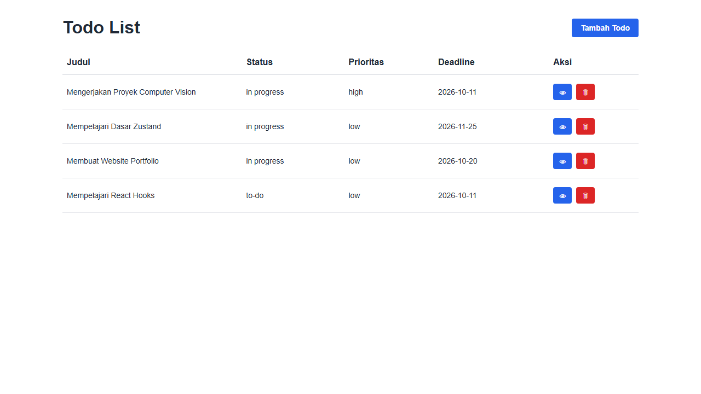
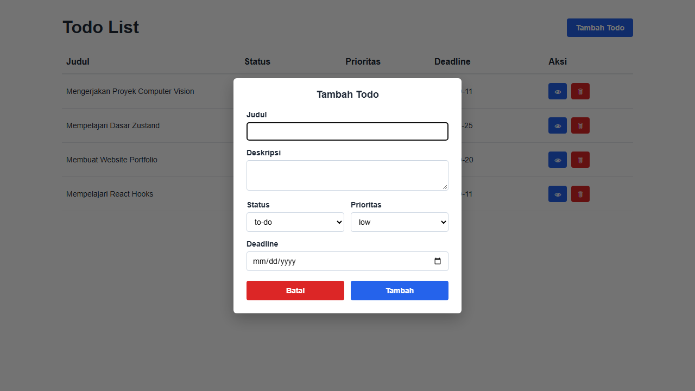
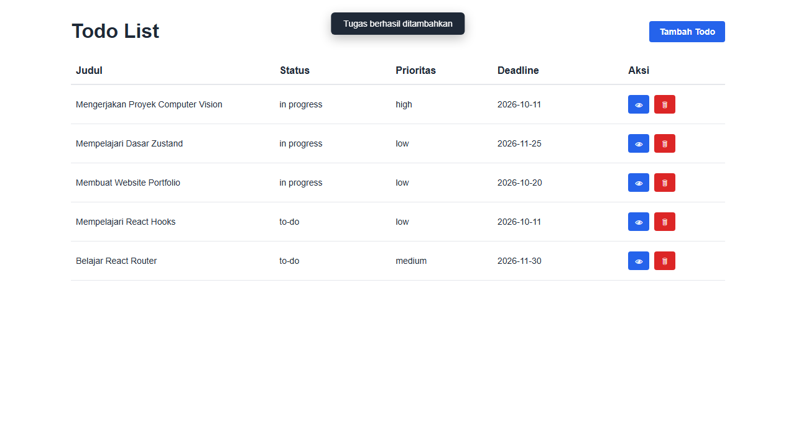
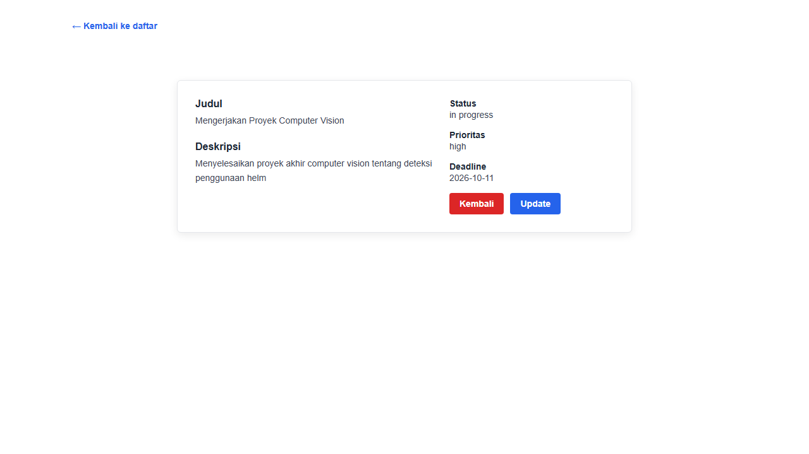
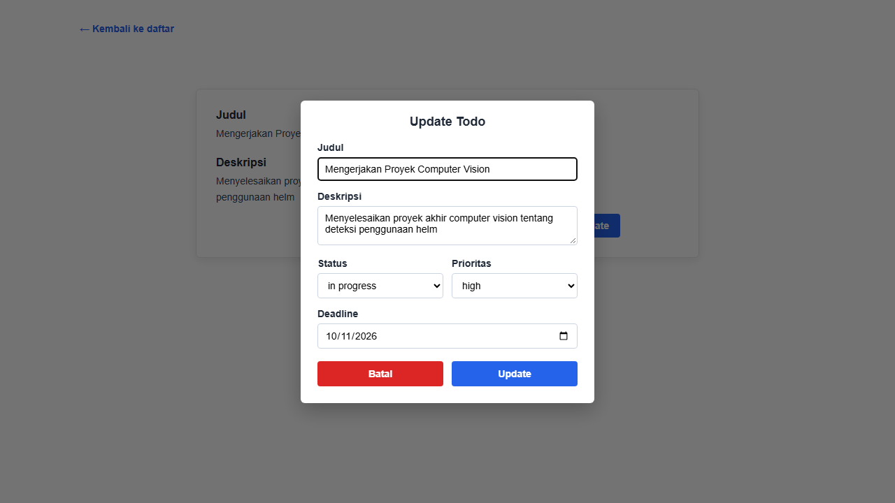
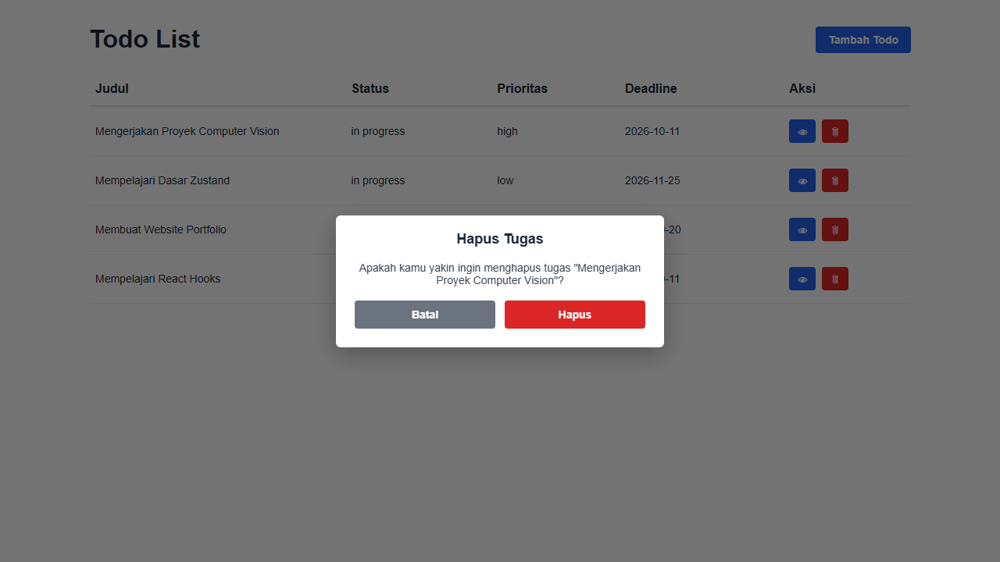
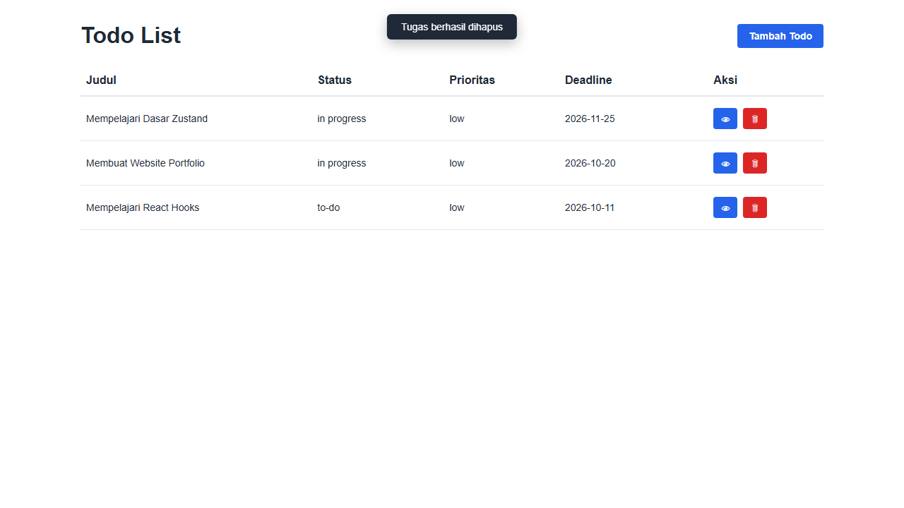

# Todo List — Aplikasi Frontend React.js

Aplikasi To-List untuk mengelola daftar tugas sehari-hari. Dibangun menggunakan **React.js**
(dengan Vite) dan **React Router**, bersifat *frontend only* dengan data dummy — tanpa backend
dan tanpa pemanggilan REST API.

> Kuis Praktikum — Pemrograman Web 2

## Fitur

| Fitur | Keterangan |
|---|---|
| Menampilkan Tugas | Daftar tugas beserta judul, status, prioritas, dan deadline |
| Melihat Detail Tugas | Halaman detail `/todo/:id` berisi informasi lengkap tugas |
| Menambahkan Tugas | Formulir **Tambah Todo** (judul, deskripsi, status, prioritas, deadline) |
| Memperbarui Tugas | Formulir **Update Todo** untuk mengubah data tugas yang ada |
| Menghapus Tugas | Tombol hapus dengan **konfirmasi penghapusan** |
| React State | Seluruh perubahan data dikelola lewat `useState`, tanpa reload halaman |
| Umpan Balik | Toast notifikasi pada operasi tambah, ubah, dan hapus |

## Struktur Data Tugas

```json
{
  "id": 1,
  "title": "Mengerjakan Proyek Computer Vision",
  "description": "Menyelesaikan proyek akhir computer vision tentang deteksi penggunaan helm",
  "priority": "high",
  "deadline": "2026-10-11",
  "status": "in progress"
}
```

## Cara Menjalankan

```bash
npm install
npm run dev
```

Aplikasi berjalan di `http://localhost:5173`.

Build produksi:

```bash
npm run build
npm run preview
```

## Struktur Proyek

```
todo-react/
├── index.html
├── package.json
├── vite.config.js
├── shot.mjs                 # script pengambilan screenshot (Playwright)
├── docs/                    # screenshot hasil implementasi
├── src/
│   ├── main.jsx
│   ├── App.jsx              # state utama + routing
│   ├── index.css
│   └── components/
│       ├── TodoList.jsx     # tabel daftar tugas
│       ├── TodoDetail.jsx   # halaman detail tugas
│       ├── TodoForm.jsx     # modal tambah / update
│       └── ConfirmDialog.jsx# konfirmasi hapus
```

## Screenshot Hasil Implementasi

### 1. Daftar Tugas



### 2. Modal Tambah Todo



### 3. Penambahan Tugas Berhasil



### 4. Detail Tugas



### 5. Modal Update Todo



### 6. Konfirmasi Penghapusan



### 7. Penghapusan Berhasil (Umpan Balik)



## Catatan Integrasi REST API

Endpoint berikut **belum dipanggil** pada kuis ini, hanya dijadikan referensi struktur data
untuk pertemuan selanjutnya:

| Endpoint | Method | Keterangan |
|---|---|---|
| `/api/todos` | GET | Mengambil semua tugas |
| `/api/todos/:id` | GET | Mengambil tugas berdasarkan ID |
| `/api/todos` | POST | Menambah tugas |
| `/api/todos/:id` | PUT | Memperbarui tugas berdasarkan ID |
| `/api/todos/:id` | DELETE | Menghapus tugas berdasarkan ID |
